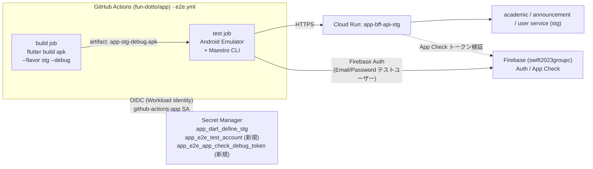

# App E2E テスト導入設計

- 作成日: 2026-11-10
- ステータス: Draft
- 対象: `fun-dotto/app`(アプリ・GitHub Actions)、`fun-dotto/infra`(Terraform)

## 1. 背景と目的

現在の App の自動テストは `melos run test:unit_tests`(Widget / Unit テスト)のみで、実機相当の環境で「起動 → ログイン → 主要画面の操作 → 実 API からのデータ表示」を通して確認する仕組みがない。Firebase / API 連携・ルーティング・ネイティブ権限ダイアログなどの統合部分の不具合は、リリース後(OTA 配信後)に手動確認で見つかっている。

本設計では、次の方針で E2E テストを導入する。

| 項目 | 決定事項 |
| --- | --- |
| E2E フレームワーク | [Maestro](https://maestro.dev/) |
| 実行基盤 | GitHub Actions(セルフホストなし。GitHub-hosted runner のみ) |
| 検証環境 | Stg 環境(`stg` フレーバー + Stg の `app-bff-api`) |

### 目的

1. 主要ユーザーフロー(クリティカルパス)の回帰を自動検知する。
2. Stg のバックエンドとアプリを組み合わせた状態でのリリース前確認を自動化する。

### 非目的

- Widget / Unit テストの置き換え(責務は従来どおり。E2E は少数の主要フローに絞る)。
- Prd / Dev 環境に対する E2E。
- Google アカウント選択 UI を含むログインフロー自体の自動化(§5.3 参照。手動確認を継続)。
- パフォーマンス・負荷テスト。

## 2. 現状(調査結果)

| 項目 | 現状 |
| --- | --- |
| アプリ構成 | Flutter(`apps/dotto`)。Melos モノレポ。mise でツール管理 |
| フレーバー | `dev` / `stg` / `prd`(Android は加えて `store`)。`applicationId` は `jp.ac.fun.dotto.{dev,stg,prd}`、iOS の Bundle ID も同様 |
| API 接続先 | `--dart-define-from-file=dart_defines/<flavor>.json` の `APP_API_BASE_URL`。ファイルは Secret Manager(`app_dart_define_{dev,stg,prd}`)から `mise run fetch:dart_defines` で取得 |
| 認証 | Google Sign-In → Firebase Auth(`signInWithCredential`)。Email/Password 経路なし |
| App Check | `kReleaseMode` なら Play Integrity / App Attest、それ以外は Debug Provider |
| 起動時の権限ダイアログ | `main()` で通知許可・位置情報許可をリクエスト |
| Stg バックエンド | Cloud Run `app-bff-api-stg`(`INGRESS_TRAFFIC_ALL`、`invoker_iam_disabled = true`、`min_instance_count = 0`)。`academic` / `announcement` / `user` の各 service に接続。`firebaseappcheck.tokenVerifier` を持つ |
| GitHub Actions → GCP | Workload Identity 経由で `github-actions-app` SA を利用(`vars.GCP_WORKLOAD_IDENTITY_PROVIDER` / `vars.GCP_SERVICE_ACCOUNT`)。Secret Manager の `app_*` シークレットは `app_secret_accessor_members` に列挙したメンバーのみ参照可 |
| 既存 CI | `ci.yml`(Test / Lint、`ubuntu-latest`)。ビルドは `deploy-ota.yml`(macOS 27 / Ubuntu) |
| Firebase プロジェクト | dev / stg / prd で **同一の `swift2023groupc`** を共有(アプリ ID のみ分離)。Firebase Auth のユーザーは全環境で共有される点に注意 |

## 3. 方針と技術選定

### 3.1 Maestro を選ぶ理由

- YAML で宣言的にフローを書けるため、Dart のテストコードに不慣れなメンバーでも保守しやすい。
- Android(エミュレータ)と iOS(Simulator)を同じフロー定義で実行できる。
- アプリ本体のテストコードや `integration_test` 用の依存追加が不要(ブラックボックステスト)。ただしアプリ側に要素の識別子(§6.2)は必要。
- 権限ダイアログなどネイティブ UI も操作できる。

### 3.2 実行基盤: GitHub Actions のみ

Maestro Cloud は使わず、GitHub-hosted runner 上で Maestro CLI を実行する。

| プラットフォーム | Runner | 実行環境 |
| --- | --- | --- |
| Android(Phase 1) | `ubuntu-latest`(KVM 有効) | `reactivecircus/android-emulator-runner` で AVD を起動 |
| iOS(Phase 2) | `macos-27`(既存 `deploy-ota.yml` と同じ) | `xcrun simctl` で Simulator を起動 |

**段階導入**: Android エミュレータは Linux runner で安価・高速に回せるため Phase 1 とし、iOS は Phase 1 の安定化後に追加する(macOS runner はコスト・実行時間が大きい)。

### 3.3 検証環境: Stg

- `stg` フレーバー(`jp.ac.fun.dotto.stg`)をビルドし、`dart_defines/stg.json` の Stg `app-bff-api` に接続する。
- Dev は不安定になり得る、Prd は本番データに影響し得るため対象外。
- 外部サービスのモックは行わず、Stg の実 API を叩く(結合の検証が目的のため)。

## 4. 全体アーキテクチャ



### 4.1 ジョブ構成(`.github/workflows/e2e.yml`)

1. **build**(`ubuntu-latest`)
   - GCP に Workload Identity で認証 → `setup-ci`(mise / melos bootstrap、`fetch:dart_defines` 含む)。
   - E2E 用シークレットを Secret Manager から取得し、`--dart-define` で渡して `flutter build apk --debug --flavor stg` を実行。
   - APK を artifact としてアップロード。
2. **android**(`ubuntu-latest`、build に依存)
   - Stg ウォームアップ(§7.3)。
   - AVD 起動 → APK インストール → `maestro test .maestro/` を実行。
   - 結果(JUnit XML、スクリーンショット、動画)を artifact として保存。
3. **ios**(Phase 2、`macos-27`)
   - 同様に `flutter build ios --simulator --debug --flavor stg` → Simulator 起動 → Maestro 実行。
4. **notify**
   - 既存の Deploy OTA と同様に Slack へ結果を通知(失敗時のみ、もしくは Nightly のみ)。

### 4.2 トリガー

| トリガー | 実行内容 | 備考 |
| --- | --- | --- |
| `schedule`(毎日。既存 CI の cron と時間をずらす) | 全フロー | Stg バックエンドの変更起因の回帰も検知する主力 |
| `workflow_dispatch` | 全フロー / フロー指定 | 手動確認・原因調査用 |
| `pull_request`(ラベル `e2e` 付与時、`labeled` / `synchronize`) | スモークフローのみ | UI 変更 PR で任意に実行。ドラフトは除外 |
| `push` to `main` | スモークフローのみ | OTA 配信(`deploy-ota.yml`)の前提確認として使う。必須化は §9 の安定化後 |

- `concurrency` は `e2e-stg`(固定グループ、`cancel-in-progress: false`)とする。**テストアカウントと Stg データを共有するため、同時実行を禁止する**(§7.2)。
- 当初は required status check にしない(フレーキーさが分かるまで)。

### 4.3 権限

既存ワークフローと同様、`permissions: { contents: read, id-token: write }` とする。PR(fork)からはシークレットが渡らないため、fork からの PR では E2E を実行しない(`github.event.pull_request.head.repo.full_name == github.repository` を条件に含める)。

## 5. テスト設計

### 5.1 ディレクトリ構成

```
.maestro/
  config.yaml            # フロー実行順・タグの定義
  flows/
    smoke/               # tag: smoke  (PR / main で実行)
      01_launch.yaml
      02_tab_navigation.yaml
    regression/          # tag: regression  (Nightly で実行)
      timetable.yaml
      announcement.yaml
      bus.yaml
      subject_search.yaml
  subflows/
    launch_app.yaml      # clearState + launchApp + 権限ダイアログ処理 + 自動ログイン待機
    dismiss_dialogs.yaml # アップデート案内・通知許可などの任意ダイアログを閉じる
  scripts/
    run-android.sh       # ローカル/CI 共通のエントリポイント
```

### 5.2 対象フロー(初期スコープ)

| 区分 | フロー | 確認内容 |
| --- | --- | --- |
| smoke | 起動 | クラッシュせずホーム(ルート画面)が表示される。強制アップデート / メンテナンス画面でない |
| smoke | タブ遷移 | 全タブが開き、各タブで API 由来の主要要素が表示される |
| regression | 時間割 | 登録済み科目の表示、科目詳細への遷移 |
| regression | お知らせ | 一覧表示 → 詳細表示 |
| regression | バス | 発着情報の表示、方向切り替え |
| regression | 科目検索 | キーワード検索 → 結果表示 → 詳細遷移 |

フローは「Stg の API が返す内容」に依存しすぎないよう、**固定のテスト用データ(§7.2)** または **構造(要素の存在)** のみを検証し、日々変わる値(日付・運行状況)の完全一致は避ける。

### 5.3 認証の扱い(最重要の設計判断)

現状のログインは Google Sign-In のネイティブアカウント選択 UI を経由し、CI で安定して自動化できない(2 段階認証・bot 検知・UI 変更に弱く、アカウントがロックされるリスクもある)。Stg の `app-bff-api` は実 Firebase ID token を検証するため、Firebase Auth Emulator に差し替えることもできない。

| 案 | 内容 | 評価 |
| --- | --- | --- |
| A. Google ログイン UI を Maestro で操作 | 実アカウントで UI 操作 | 不安定・ロックリスク。**不採用** |
| B. Firebase Auth Emulator | ローカルの Emulator で認証 | Stg API が検証できない。**不採用** |
| C. Custom Token でサインイン | Admin SDK でトークン生成 → `signInWithCustomToken` | `email` クレームが ID token に載らず、メールで学内アカウントを識別するバックエンドと整合しない可能性。**不採用** |
| **D. Email/Password のテスト専用ユーザー(採用)** | E2E ビルドのみ、起動時に `signInWithEmailAndPassword` で自動サインイン | 実 Firebase / 実 ID token / `email` クレームを備える。実装が小さい |

**採用案 D の仕様**

- 認証情報は **ビルド時の `--dart-define`** で渡す(`E2E_AUTH_EMAIL` / `E2E_AUTH_PASSWORD`)。未指定(通常ビルド)では `String.fromEnvironment` が空文字となり、自動サインインのコードパスは実行されない。
- E2E 用 APK は CI の artifact のみで、`retention-days: 1`。配布(Firebase App Distribution / ストア)には使わない。認証情報が APK に含まれるため、配布フローから分離する。
- テストユーザーは Stg 専用のダミーアカウントで、権限は一般ユーザー相当。パスワードは Secret Manager で管理する。
- Google ログインフロー自体(アカウント選択 → サインイン)は E2E の対象外とし、リリース前の手動確認を継続する。

> **注意**: Firebase プロジェクトは dev / stg / prd で共有のため、テストユーザーは Prd からも見える。メールアドレスは明確なテスト用の名前にし、バックエンド側で学内ドメイン以外の権限が付かないことを確認する。(§10 オープンクエスチョン)

## 6. App リポジトリの変更点

### 6.1 App Check

E2E 用の Debug ビルド(`kReleaseMode == false`)は Debug Provider を使う。エミュレータ上でランダムなデバッグトークンが毎回生成されると Stg 側で検証できないため、**固定のデバッグトークン**を Firebase に事前登録し、ビルド時に注入する。

- `apps/dotto/lib/main.dart` の `AndroidDebugProvider` / `AppleDebugProvider` に、`--dart-define=E2E_APP_CHECK_DEBUG_TOKEN` の値(空なら `null`)を `debugToken` として渡す。
- トークンは Secret Manager `app_e2e_app_check_debug_token` から取得する。
- Release ビルド(OTA / ストア)には影響しない(`kReleaseMode` 分岐は維持)。

> Debug ビルドを使う理由: Release ビルドは Play Integrity / App Attest を使うため、エミュレータ / Simulator では通らない。

### 6.2 要素の識別子

Flutter は Maestro から `text` や accessibility ラベルで要素を特定できるが、l10n による文言変更に弱い。主要な操作対象には `Semantics(identifier: ...)`(Android では `resource-id`、iOS では `accessibilityIdentifier` に対応)を付与し、Maestro では `id:` で指定する。

- 命名規則: `<screen>_<element>`(例: `root_tab_timetable`、`timetable_course_card`)。
- 識別子は定数クラス(例: `lib/foundation/e2e/e2e_ids.dart`)にまとめ、アプリ側と `.maestro/` の双方で同じ値を参照できるようにする(Maestro 側は YAML 内で文字列を直接記述するため、変更時は両方を更新する。重複を避けるためフロー内の識別子は subflow の `env` 経由で定義する)。
- 初期スコープは §5.2 のフローに必要な最小限のみ。

### 6.3 E2E 安定化のための起動時処理

- 通知許可・位置情報許可: E2E 起動時は Maestro の `launchApp` の `permissions` 指定(`all: allow`)で自動許可する。アプリ側の変更は不要。
- アップデート案内ダイアログ(`isLatestAppVersion == false`)などの任意ダイアログは、`subflows/dismiss_dialogs.yaml` で `runFlow: when: visible` を使い、出た場合のみ閉じる。
- 自動サインイン後にルート画面が表示されるまでの待機は `extendedWaitUntil` で行う(Stg の Cold Start を考慮してタイムアウトは 60 秒程度)。

### 6.4 mise タスク

ローカルでも CI と同じ手順で実行できるようにする。

```toml
[tasks."e2e:build:android"]
run = "cd apps/dotto && flutter build apk --debug --flavor stg --dart-define-from-file=dart_defines/stg.json --dart-define=E2E_AUTH_EMAIL=$E2E_AUTH_EMAIL --dart-define=E2E_AUTH_PASSWORD=$E2E_AUTH_PASSWORD --dart-define=E2E_APP_CHECK_DEBUG_TOKEN=$E2E_APP_CHECK_DEBUG_TOKEN"

[tasks."e2e:test:android"]
run = "maestro test --include-tags=${E2E_TAGS:-smoke} .maestro/flows"
```

- Maestro CLI は mise で管理する(ツールのバージョンを `mise.toml` に固定し、既存方針の `minimum_release_age` に従う)。実際に mise のレジストリで提供されるか(`aqua:` / `ubi:` 経由など)は導入時に確認する。

## 7. インフラ構成(`fun-dotto/infra`)

### 7.1 追加・変更するリソース

| # | 内容 | Terraform プロジェクト | 備考 |
| --- | --- | --- | --- |
| 1 | Secret Manager に `app_e2e_auth_account`(JSON: `email` / `password`)を追加 | `foundation/secret-manager` | 既存の `app-dart-define-stg.tf` と同形式のファイルを追加。`app_secret_accessor_members` にアクセサ権限が付くため `github-actions-app` SA から参照可能。**シークレットの値は Terraform 管理外**(`google_secret_manager_secret_version` は作らず、手動 / スクリプトで登録) |
| 2 | Secret Manager に `app_e2e_app_check_debug_token` を追加 | 同上 | 同様に値は管理外 |
| 3 | Stg アプリ(Android / iOS)に App Check デバッグトークンを登録 | `foundation/project`(または新規 `foundation/firebase-app-check`) | `google_firebase_app_check_debug_token`(`google-beta`)を利用。Android の `1:107577467292:android:99fa38c96f4496aa06e859`、iOS の `1:107577467292:ios:b60af28764a55b0a06e859` が対象。トークン値は変数 / `TF_VAR` 経由で渡し、tfstate(GCS、非公開)に格納される点を許容できるか要確認 |
| 4 | `terraform-ci` SA の権限確認 | `foundation/iam-workload-identity` | 上記 3 のため `roles/firebaseappcheck.admin` が必要な場合は追加する(project-wide `roles/owner` は付与しない、という既存方針を維持) |
| 5 | (任意)Stg の `app-bff-api` の最小インスタンス数 | `server/app-bff-api/stg` | Cold Start 対策として E2E 実行時間帯のみ `min_instance_count = 1` にする案。常時 1 にすると課金が増えるため、まずはウォームアップ(§7.3)で対応し、不安定なら再検討する |

`github-actions-app` SA の `roles/iam.workloadIdentityUser` は、`fun-dotto/app` リポジトリに対して既に付与済みのため追加不要。ワークフローが `app` リポジトリ内で動く限り、既存の認証設定をそのまま使える。

### 7.2 Stg のテストデータと分離

- E2E 専用のテストユーザー(§5.3)に紐づく固定データ(登録済み科目など)を Stg の DB に用意する。投入手段は SQL / 既存の admin 経路のいずれかとし、手順は `docs/` に runbook として記録する(初期セットアップ時のみ)。
- フローは「状態を変更したら元に戻す」(例: 科目を登録したら同フロー内で解除する)原則とし、各フローを任意の順序・再実行で実行できるようにする。
- 同一アカウント・同一データを共有するため、ワークフローの `concurrency` グループを固定にして直列化する(§4.2)。複数アカウントによる並列化は将来の課題とする。
- Stg を利用する他の開発者の手動確認データと衝突しないよう、E2E 専用ユーザーのデータにのみ書き込む。

### 7.3 Stg の可用性

- `app-bff-api-stg` は `min_instance_count = 0` で、さらに下流 service も同様のため、最初のリクエストは Cold Start で遅くなる。
- テスト実行前に、BFF の疎通確認(`curl` で数回リトライ)を行うウォームアップステップを入れる。呼び先 URL は `dart_defines/stg.json` の `APP_API_BASE_URL` から取得する。
- Stg が起動できない場合は E2E 失敗と区別するため、ウォームアップ失敗は別ステップとして失敗させ、Slack 通知に反映する。
- BFF の `ingress = INGRESS_TRAFFIC_ALL` / `invoker_iam_disabled = true` のため、GitHub-hosted runner から直接アクセス可能。ネットワーク設定(VPC / IP 制限)の追加は不要。

## 8. 認証情報・シークレット管理

| 情報 | 保管場所 | 参照元 | 備考 |
| --- | --- | --- | --- |
| Stg の dart-define | Secret Manager `app_dart_define_stg`(既存) | `mise run fetch:dart_defines` | 既存運用のまま |
| E2E テストユーザー | Secret Manager `app_e2e_auth_account`(新規) | build job で `gcloud secrets versions access` | 取得後は `::add-mask::` でログにマスク |
| App Check デバッグトークン | Secret Manager `app_e2e_app_check_debug_token`(新規) | 同上 | 同上 |
| GCP 認証 | Workload Identity(既存 `vars.GCP_*`) | `google-github-actions/auth` | 長期キー不使用 |

- GitHub Secrets には E2E 専用の値を追加しない(既存方針どおり Secret Manager を正とする)。
- APK 内に認証情報が埋め込まれるため、artifact の保持期間は 1 日とし、ダウンロード可能なユーザーは Repo の権限に従う。パスワードは定期的にローテーションし、漏洩時は Firebase Console で当該ユーザーを無効化する。

## 9. 導入ステップ

| Phase | 内容 | 完了条件 |
| --- | --- | --- |
| 0. PoC(ローカル) | Maestro でローカルのエミュレータに stg ビルドを入れ、起動〜タブ遷移まで手動実行。Debug App Check トークンの固定注入方法(`debugToken` が Android / iOS のプラグインで有効か)を検証 | Stg の API からデータ表示まで通る |
| 1. インフラ | infra リポジトリで Secret Manager / App Check トークン登録 / 権限を追加、Stg にテストユーザーとデータを投入 | `github-actions-app` から両シークレットが取得できる |
| 2. App 対応 | 自動サインイン・Debug トークン注入・`Semantics` 識別子・`.maestro/` スモークフロー・mise タスク | ローカルで `mise run e2e:test:android` が成功 |
| 3. GHA(Android) | `e2e.yml` 追加。Nightly + 手動 + ラベル起動 | 連続 10 回程度の Nightly 成功率が 95% 以上 |
| 4. 拡張 | regression フロー追加、`main` push での実行、Slack 通知 | 主要フローをカバー |
| 5. iOS | macOS runner + Simulator で同フローを実行 | iOS でも Nightly が安定 |
| 6. ゲート化 | 安定していれば required status check / OTA 配信前の必須ステップに昇格 | 運用チームの合意 |

> インフラの変更(Phase 1)は、App 側の Phase 2 以降より先に infra リポジトリで Digger 経由の plan / apply を済ませる。

## 10. リスクと未決事項

| 項目 | 内容 / 対応 |
| --- | --- |
| フレーキーさ | エミュレータの起動 / Cold Start / ネットワーク要因。`extendedWaitUntil`、ウォームアップ、失敗時の 1 回リトライ(ジョブ単位)で緩和。要因別に記録して判断する |
| Stg の状態依存 | バックエンドの Stg デプロイ状況(`latest` イメージ)に結果が左右される。失敗時は API 側の原因か App 側かを artifact(ログ・動画)で切り分ける |
| テストユーザーが Prd と共有される | Firebase Auth がプロジェクト共有のため。**オープンクエスチョン**: 本アカウントが Prd のバックエンドで権限を持たないこと、学内ドメインのチェック有無を確認する |
| APK に認証情報を含む | artifact の管理(保持期間 1 日)と、配布フローとの分離で対応。代替として、起動時に Maestro 側でフォーム入力させる E2E 専用サインイン画面を用意する案もあるが、アプリ側の変更が大きいため現時点では採用しない |
| `debugToken` の Flutter プラグイン対応 | `firebase_app_check` が固定のデバッグトークンを受け付けるか、Phase 0 で確認する。不可の場合は、ネイティブ側(Android の `DebugAppCheckProviderFactory` / iOS の `FIRAppCheckDebugProvider` 環境変数)での注入に切り替える |
| Maestro と Flutter | Flutter のセマンティクスツリーが Maestro から見える前提。`Semantics(identifier:)` が両 OS で期待通り反映されるかを Phase 0 で確認する |
| macOS runner のコスト | iOS は Nightly のみで開始し、PR / main では実行しない |
| Maestro のバージョン管理 | CLI のバージョンを固定し、Renovate(`renovate.json` 既存)で更新する |
| 通知許可 / 位置情報許可 | Maestro の `permissions` 指定で許可する。iOS Simulator での挙動差は Phase 5 で確認 |

## 11. 代替案(検討したが採用しなかったもの)

| 案 | 不採用の理由 |
| --- | --- |
| Flutter `integration_test` | Dart で書けるがネイティブ権限ダイアログの操作に弱く、アプリ側にテスト依存が入る。指定により Maestro を採用 |
| Maestro Cloud | GitHub Actions で実行する指定のため対象外(コスト・外部サービス依存も増える) |
| Firebase Test Lab | Stg への外部ネットワークは問題ないが、GCP 側の設定と費用が増える。将来、実機での確認が必要になった場合に再検討 |
| Dev 環境での実行 | 開発中の不安定な変更の影響を受けやすい。Stg を採用 |
| Firebase Auth Emulator + API モック | 実 API / App Check との結合を確認できない |
